# Sharpr

**Free and open source, on-device AI image upscaling for Android and desktop.**
Make small pictures big using the power of your own GPU. Your memories never leave your device.

*A project by The Bug Slayyers.*

<p align="center">
  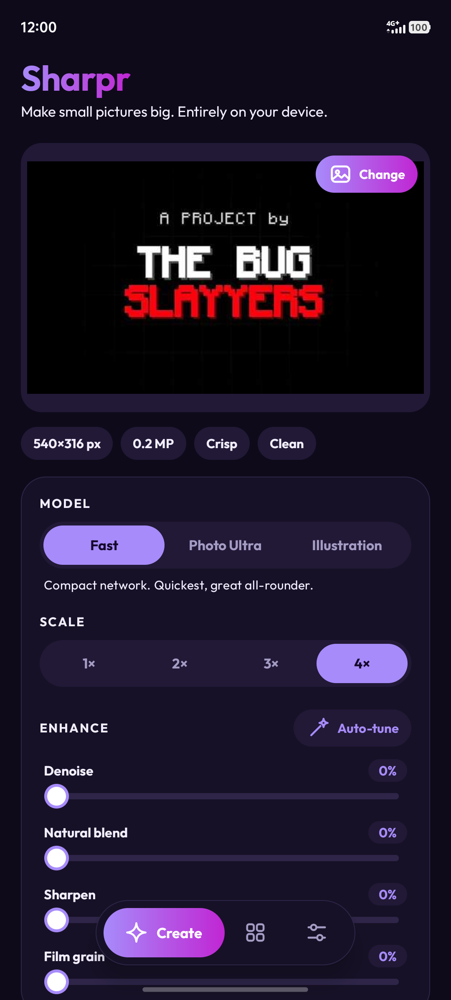
  
  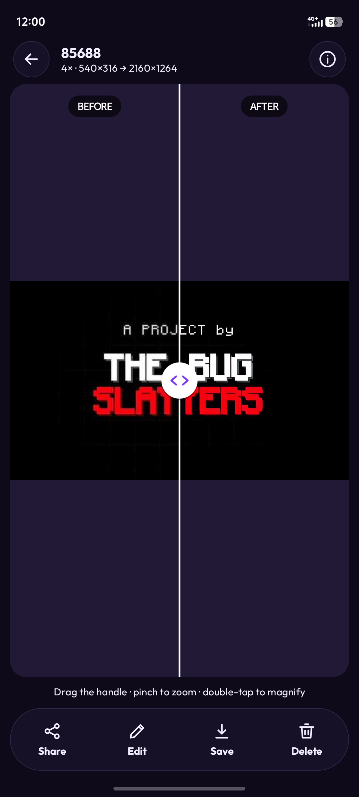
  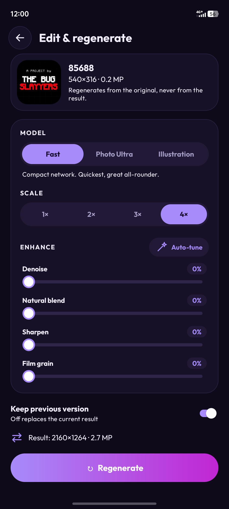
</p>

## Why Sharpr

Apps like Remini send your photos to a server. Sharpr does the work on your phone or computer: no account, no upload, no subscription.

- **Private by design.** Images are processed locally. Nothing is uploaded, nothing is tracked.
- **GPU first, CPU fallback.** Runs on the Vulkan GPU through ncnn. If the GPU fails to load, errors out or returns a bad result, Sharpr finishes the job on the CPU and tells you which engine ran. Choose Auto, GPU or CPU in Settings.
- **Smart guards.** Resolution alone never blocks an image: a blurry 2K photo is exactly what upscaling helps. Sharpr measures real sharpness on native-resolution crops and only holds back images that are both large and already crisp (you can still override unless strict guard is on). The scale is lowered automatically to stay under your output size limit, and a **1x Enhance** mode restores detail at the original size when an image is too big to enlarge.
- **Three models.** Fast (compact), Photo Ultra (Real-ESRGAN x4plus) and Illustration (Real-ESRGAN x4plus anime), at 1x to 4x.
- **Customisable.** Denoise, natural blend, sharpen and film grain; model, scale, tile size, CPU threads, FP16; output format and quality; light, dark and AMOLED themes; four purple accents; three fonts.
- **Library, compare, share, edit.** Every result is kept. Open one to compare before/after with a slider (pinch to zoom), share it, save it, or regenerate it from the original with new settings.

## Screenshots

### Android

| Create | Compare | Details | Edit |
| --- | --- | --- | --- |
| 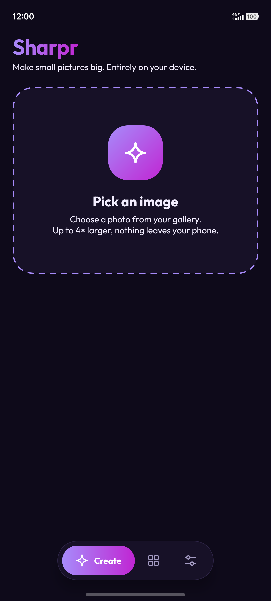 |  | 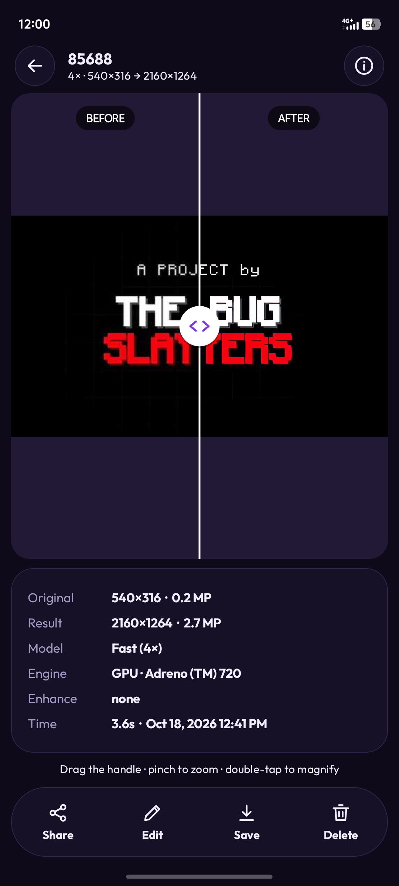 |  |

### Desktop (Kivy)

The desktop app opens in a phone-style layout and adapts as the window grows.

| Create | Compare |
| --- | --- |
| 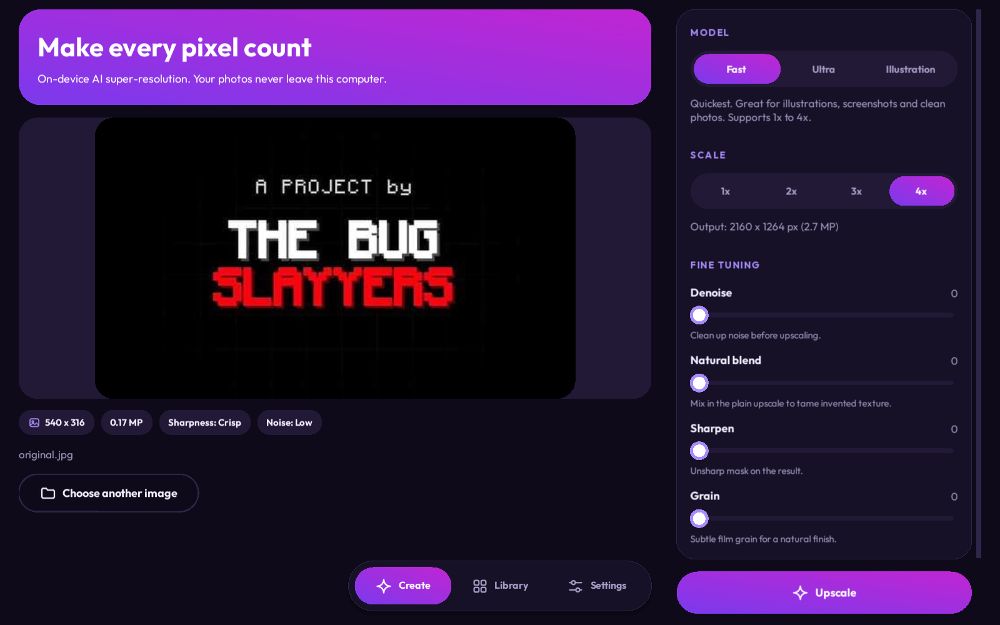 | 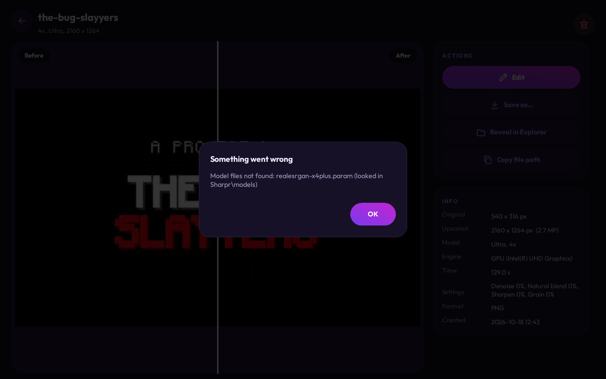 |
| **Library** | **Settings** |
| 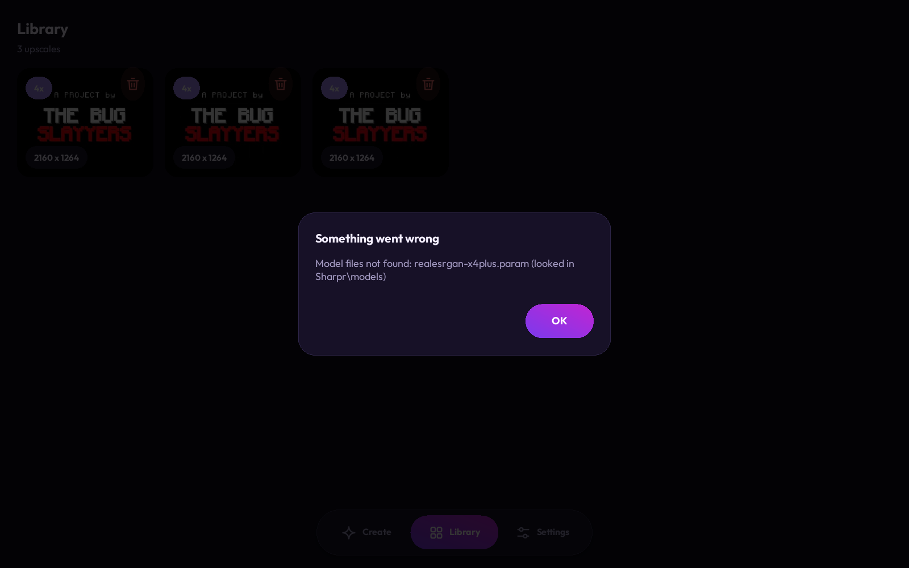 | 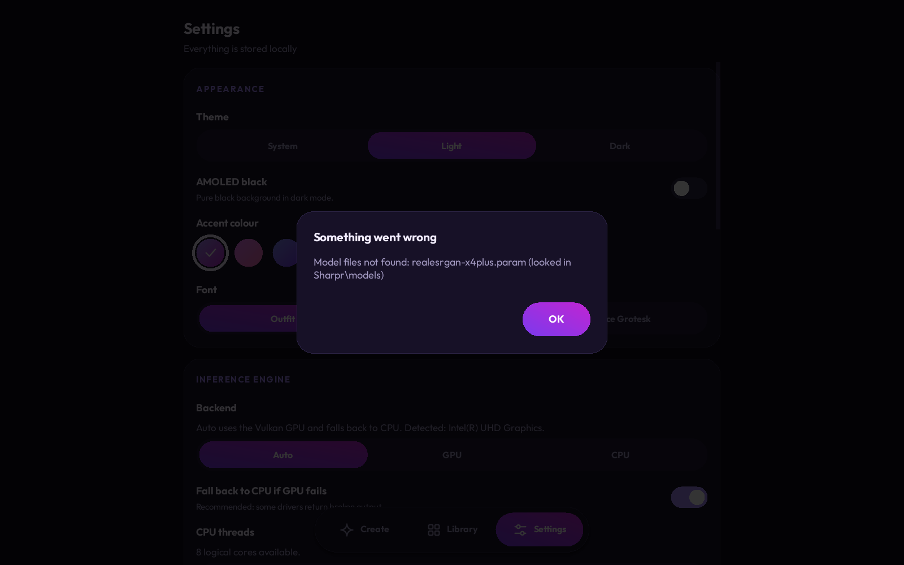 |

Light theme: [create](docs/screenshots/desktop-create-image-light.png), [compare](docs/screenshots/desktop-detail-compare-light.png), [library](docs/screenshots/desktop-library-light.png), [settings](docs/screenshots/desktop-settings-light.png).

## Samples

Original (540x316) and the result of the Fast model at 4x, generated by the desktop engine:

| Original | Sharpr 4x |
| --- | --- |
| 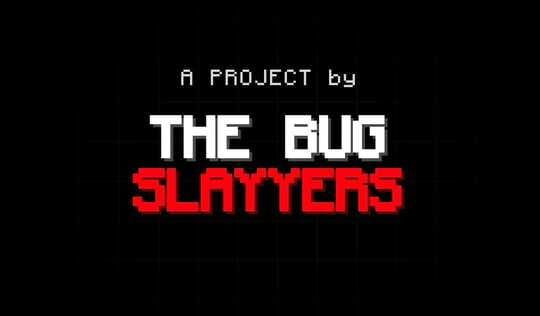 | 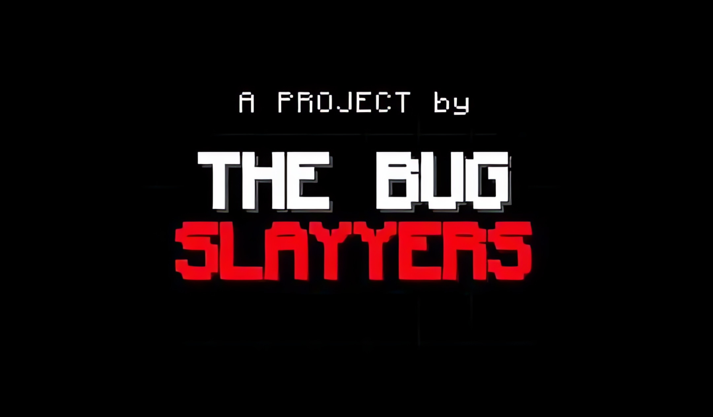 |

More outputs (Photo Ultra, Illustration, bicubic and nearest-neighbour baselines) and timings are in [`docs/samples`](docs/samples).

## Tech stack

| Layer | Technology |
| --- | --- |
| Inference | **ncnn** (Tencent), Vulkan GPU with CPU fallback, tiled Real-ESRGAN style super-resolution |
| Image processing | **OpenCV**: sharpness and noise analysis, denoise, natural blend, sharpening, film grain |
| Models | Real-ESRGAN (BSD-3-Clause): `realesr-animevideov3`, `realesrgan-x4plus`, `realesrgan-x4plus-anime` |
| Android | Kotlin, XML layouts and Fragments with custom Views, JNI + C++ (NDK 28) |
| Desktop | Python, **Kivy**, ncnn Python bindings, OpenCV |

Inference runs entirely through ncnn. OpenCV is used for analysis and for the pre- and post-processing around the network, not for running the network itself.

## Build and run

### Android

Requirements: Android Studio (or JDK 17+), Android SDK 37, NDK 28.2.13676358, CMake 3.31.6.

```powershell
scripts\setup-native.ps1      # downloads the prebuilt ncnn Vulkan libraries (~60 MB)
.\gradlew.bat :app:assembleDebug
```

The APK is at `app/build/outputs/apk/debug/app-debug.apk`. minSdk 26. Tested on a Snapdragon 7 Gen 3 device (Adreno 720) running Android 16: a 540x316 image to 4x took about 3.5 s on the GPU and about 14 s on the CPU.

### Desktop

```powershell
cd desktop
.\run.ps1
```

This creates a virtual environment, installs `requirements.txt` and starts the app. The desktop app reads the models from `app/src/main/assets/models`. Kivy is cross-platform; it has been tested on Windows 11 so far. See [`desktop/README.md`](desktop/README.md) for details.

## Roadmap

- Google Play release (coming soon)
- iOS (coming soon)
- Background processing with a foreground service on Android

## Project layout

```
app/        Android app (Kotlin, XML, C++/ncnn via JNI)
desktop/    Kivy desktop app
docs/       README screenshots and sample outputs
scripts/    Native dependency setup
```

## License and credits

Released under the MIT License (see `LICENSE`). Third-party components keep their own licenses: ncnn (BSD-3-Clause), OpenCV (Apache-2.0), Real-ESRGAN (BSD-3-Clause), Kivy (MIT), Outfit, Plus Jakarta Sans and Space Grotesk fonts (SIL OFL), Monocraft (SIL OFL).

---

A project by **The Bug <span style="color:red">Slayyers</span>**
